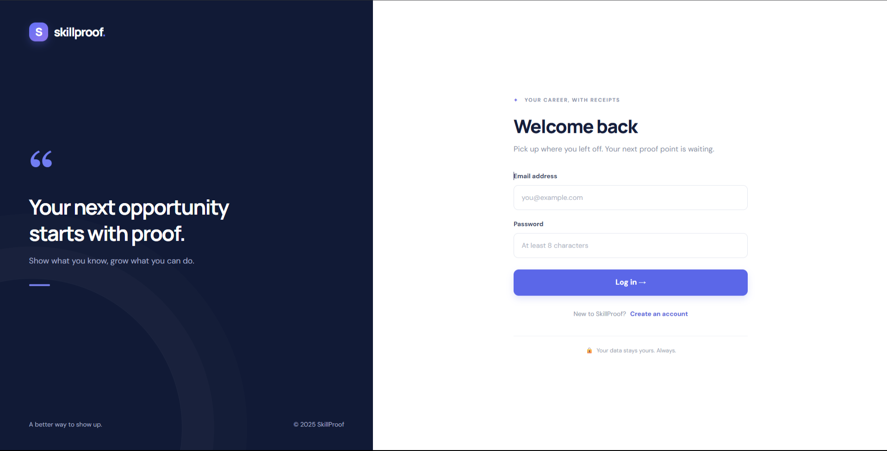
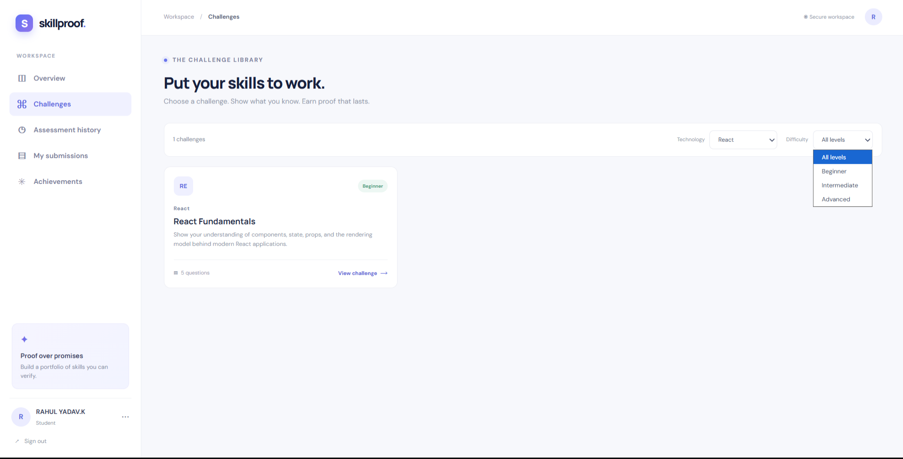
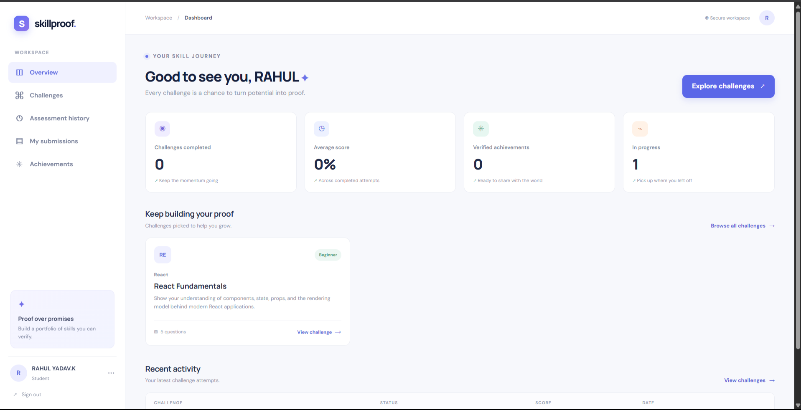

# SkillProof — Show What You Know

SkillProof is a full-stack skill assessment platform that helps students demonstrate their technical knowledge through assessments, track their progress, submit practical work, and earn verifiable skill receipts.

Instead of simply listing skills on a resume, users can demonstrate what they know through assessment results and practical submissions.

## Application Screenshots

### Login Page
)

### Student Dashboard
)

### Challenge Library


### Assessment History


## Key Features

### Student Features
- User registration, login, and logout.
- Personalized student dashboard.
- Browse technical challenges.
- Filter challenges by technology and difficulty.
- Attempt assessments and submit answers.
- Automatic assessment scoring.
- Track completed and ongoing assessments.
- View assessment history and scores.
- Monitor skill progress.
- Submit practical project work.
- View reviewer feedback and submission decisions.
- Earn digitally signed skill receipts.
- Public receipt verification.

### Admin Features
- Admin authentication and role-based access.
- Create, update, and delete challenges.
- Manage assessment questions.
- Publish challenges.
- Manage user roles.

### Reviewer Features
- Access practical submissions assigned for review.
- Review submitted work.
- Record review decisions and feedback.

## Technology Stack

| Layer | Technologies |
|---|---|
| Frontend | React, TypeScript, Vite |
| Styling | Tailwind CSS |
| Routing | React Router |
| Data fetching | TanStack Query |
| Backend | Node.js, Express, TypeScript |
| Database | PostgreSQL |
| ORM | Drizzle ORM |
| Validation | Zod |
| Authentication | JWT, bcrypt, HttpOnly cookies |
| Testing | Vitest, Supertest, Playwright |
| Development | npm, Git, GitHub |
| Database migrations | Drizzle Kit |

## System Architecture

SkillProof follows a full-stack client-server architecture.

```text
              STUDENT / ADMIN / REVIEWER
                         |
                         v
                REACT FRONTEND
                 TypeScript
                    Vite
                         |
                         v
                  EXPRESS API
                  TypeScript
                         |
             +-----------+-----------+
             |           |           |
             v           v           v
         AUTHENTI-    CHALLENGE    ASSESSMENT
         CATION       MANAGEMENT   SERVICES
             |           |           |
             +-----------+-----------+
                         |
                         v
                   DRIZZLE ORM
                         |
                         v
                   POSTGRESQL
                         |
                         v
                PERSISTENT DATA
```

## Project Structure

```text
SkillProof/
│
├── client/
│   ├── src/
│   ├── e2e/
│   └── package.json
│
├── server/
│   ├── src/
│   │   ├── db/
│   │   ├── services/
│   │   └── app.ts
│   ├── drizzle/
│   ├── test/
│   └── package.json
│
├── shared/
│
├── docs/
│   └── screenshots/
│
├── scripts/
│
├── docker-compose.yml
├── .env.example
├── .gitignore
├── package.json
├── package-lock.json
└── README.md
```

## Getting Started

Follow these instructions to run SkillProof on your local machine.

### Prerequisites

Install the following:

- Node.js 22.12 or newer
- npm
- PostgreSQL 17 (or a compatible PostgreSQL installation)
- Git

### 1. Clone the Repository

```bash
git clone YOUR_GITHUB_REPOSITORY_URL
```

Navigate into the project:

```bash
cd SkillProof
```

### 2. Install Dependencies

```bash
npm ci
```

### 3. Configure Environment Variables

Create your local environment file:

**Windows PowerShell:**

```powershell
Copy-Item .env.example .env
```

Open `.env` and configure the database connection and required secrets.

Use unique, secure values for your JWT and receipt-signing secrets.

Set `SEED_ADMIN_PASSWORD` to a password of at least 12 characters.

Do not upload `.env` to GitHub.

### 4. Configure PostgreSQL

Ensure your PostgreSQL service is running.

For the local Windows setup, you can use:

```powershell
.\scripts\Configure-LocalDatabase.ps1
```

Follow the prompts to configure the PostgreSQL connection.

Alternatively, configure the `DATABASE_URL` in `.env` to point to your own PostgreSQL database.

### 5. Run Database Migrations

```bash
npm run db:migrate
```

This creates the application database tables using Drizzle migrations.

### 6. Seed the Database

```bash
npm run db:seed
```

The seed script creates the initial admin account and sample application data.

The seeded admin email is:

```text
admin@skillproof.local
```

Use the password configured through `SEED_ADMIN_PASSWORD`.

### 7. Start the Application

```bash
npm run dev
```

The frontend and backend start together.

Open the application:

**Frontend:** http://localhost:5173

**Backend API:** http://localhost:4000

## Testing

SkillProof includes automated tests for backend functionality and frontend behavior.

### Run All Tests

```bash
npm test
```

### Run End-to-End Tests

```bash
npx playwright install chromium
npm run test:e2e
```

### Build the Application

```bash
npm run build
```

### Run Linting

```bash
npm run lint
```

## Security

Security measures implemented in SkillProof include:

- Password hashing using bcrypt.
- JWT-based authentication.
- Server-managed HttpOnly authentication cookies.
- Session revocation during logout.
- Role-based authorization.
- Server-side request validation using Zod.
- Protected API routes.
- Private student submission access.
- Cryptographic signatures for skill receipts.

## Database

SkillProof uses PostgreSQL for persistent storage and Drizzle ORM for database operations.

The database includes tables for:

- Users
- Skills
- Challenges
- Questions
- Challenge attempts
- Skill receipts
- User skills
- Practical submissions
- Reviews

Database changes are managed through Drizzle Kit migrations.

## Development and Testing Status

The project has been built and tested locally.

The latest verification run reported:

| Check | Result |
|---|---|
| Frontend build | Passed |
| Backend build | Passed |
| Automated unit and integration tests | 14 passed |
| Browser end-to-end tests | 2 passed |

These results reflect the latest local verification run and may change with future code updates.

## Future Improvements

- Deploy the application to a public hosting platform.
- Expand the challenge library.
- Add more programming languages and technical skills.
- Improve assessment analytics.
- Add additional reviewer workflows.
- Introduce richer public skill portfolios.

## Author

**Rahul Yadav K**

GitHub: https://github.com/krahulyadav27

---

**SkillProof — Show what you know. Build proof that lasts.**
## Application Screenshots

### Login Page


### Challenge Library


### Assessment History


### Application Overview


